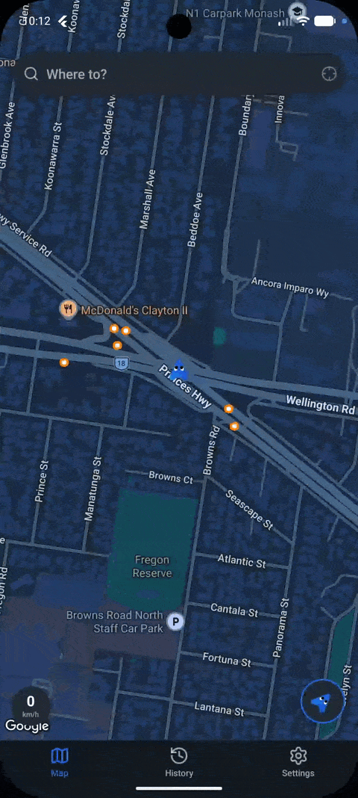
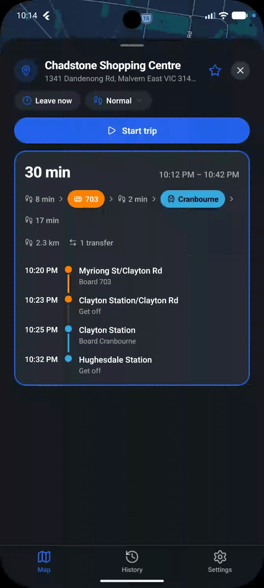
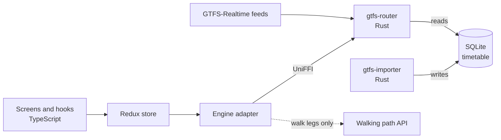

# TranSwift

A Melbourne trip planner that works offline and plans around how fast *you* walk.

Most journey planners assume everyone walks at the same pace. If you walk slowly, the "fastest" route can make you miss a connection. If you walk quickly, a route with a longer walk can be the better one. TranSwift takes your walking speed as an input, so the route it picks is the fastest for you. It also records your walks and tracks your personal bests.

<!--
Add screen recordings here once captured, then uncomment:



-->

## What it does

- **Plans trips across trains, trams and buses** from a timetable stored on the phone. No internet is needed to search.
- **Uses your walking speed.** Pick a preset or edit your own. The same trip can return different routes at different speeds.
- **Shows several options at once.** Each result trades off arrival time, walking distance and number of transfers, and you can sort by any of them.
- **Live information.** Delays, vehicle positions and service alerts appear when the transit agency publishes them.
- **Guides you during a trip.** It records your walk by GPS, tells you when to get off, and compares each walk with your previous best between the same two stops.
- **Keeps a history.** Totals, weekly charts, a walking streak, and a heatmap of every path you have walked.

## Why it was hard

A city's timetable is large. The Melbourne feed has about 4,600 distinct stopping patterns and 147,000 pattern stops, and the database file is 439 MB. Running a standard search over all of it on a phone ran out of memory, and the first versions that avoided that were too slow to use.

The work in this project is narrowing a search to the part of the network that matters before the search runs, without throwing away the best route. The next sections describe how that went.

## For engineers

### Stack

| Layer | Choice |
| --- | --- |
| App | React Native 0.81, Expo 54 (Expo Router), TypeScript, Redux Toolkit, NativeWind |
| Maps | `react-native-maps`, Google Places for search |
| Storage | On-device SQLite through `op-sqlite` |
| Routing engine | Rust, a RAPTOR implementation with its own search-space pruning |
| GTFS importer | Rust, parses and indexes a GTFS zip natively with progress reporting |
| Bridge | UniFFI via `uniffi-bindgen-react-native`, so TypeScript calls the Rust crates as typed objects |
| Realtime | GTFS-Realtime decoded in Rust with `prost` |

The repository holds roughly 10,000 lines of Rust and 18,000 lines of TypeScript.

### Architecture



### Design process: four attempts at narrowing the search

1. **Plain RAPTOR on the full feed.** Ran out of memory. Once that was avoided, reading `stop_times` from disk was too slow. The fix had to happen before RAPTOR runs.
2. **Ellipse filter.** Load only stops inside an ellipse between origin and destination. This fails wherever a river or lake separates two stops that are close on a map. Straight-line distance predicts walking reach but says little about transit reach.
3. **Straightness-scored candidates.** Score paths by how directly they point at the destination. Still geometric, and a straight-looking path can depend on an infrequent line while an indirect one catches an express.
4. **BFS-seeded corridor (current).** Let the transit graph's own connectivity and timing choose the search space. Geometry is kept only for physical limits such as walking radius and footpath transfers.

### Current pipeline

1. **Import.** A GTFS zip becomes a SQLite file of pure timetable data, plus average ride time and wait time (half the headway) per line. Patterns are de-duplicated by actual stop and time sequence.
2. **Coarse graph.** One edge per line plus walking edges between nearby stops, built once and persisted. Small enough to stay in memory when the timetable is not.
3. **Seeding.** Origin and destination are matched to stops within the rider's maximum walk distance.
4. **Balanced bidirectional BFS.** Two trees grow from both ends, always expanding the smaller frontier. The search continues past the first meeting point by a margin so alternative routes survive.
5. **Edge corridor.** Patterns near the seed paths are loaded too. Logs showed the best journey often rides a pattern that was on no seed path.
6. **Scoring and time window.** Candidates are scored with the rider's walking speed. The fifth-fastest sets the width of the timetable query window.
7. **Loader filters.** Patterns with no trip running today are dropped, and stop times are fetched only for stops served by a pattern that survives. The pattern caps in `settings.rs` are currently set to unlimited, so accuracy comes before speed.
8. **RAPTOR.** Round-based, with a Pareto frontier over arrival time, walking distance and transfers, and no SQL during the search.
9. **Fallback.** If RAPTOR errors or finds nothing, a verifier checks that a real trip exists to ride each candidate path from step 4, and returns those.

RAPTOR and its Pareto variant are published algorithms. Steps 3 to 7 are original work, shaped by hitting real memory and latency limits rather than designed on paper first.

### Decisions worth a look

- **Schema matched to the query.** A profile showed `stop_times` clustered by `(trip, sequence)` while the router always filters by stop first, which caused scattered disk seeks. Re-keying the table to `(stop, departure time, trip, sequence)` in the importer made search times stable.
- **Two stated approximations.** RAPTOR prunes by a distance lower bound and caps its frontier on busy rounds. Both can in theory drop the true optimum, in exchange for bounded worst-case cost. The code documents when that risk is real.
- **Cheap to call from the UI.** The engine warms up once on a worker thread and is reused across searches. The warm-up reloads the persisted coarse graph and took 1.3 s on the test phone below. Live departures wait for it too.
- **Realtime as an overlay.** Delays are applied in memory on top of the scheduled timetable and never written to the database.
- **Walking paths.** The router plans on straight-line walking distances. After a journey is chosen, its walk legs are fetched from a pedestrian routing API, drawn along real paths and measured, falling back to the straight line when a request fails. Walking paths by [Geoapify](https://www.geoapify.com/).

### Measured performance

Three searches from one session on a Poco F6 (Xiaomi 24069PC21G), debug build, warm engine, live Melbourne feed with realtime delays applied:

| Search | Journeys found | Engine time (load + RAPTOR) | Stops queried | Trips in window | Stop-time rows |
| --- | --- | --- | --- | --- | --- |
| Short trip | 1 | 36 ms + 1 ms | 463 | 191 | 2,086 |
| Medium trip | 1 | 318 ms + 9 ms | 1,880 | 488 | 11,034 |
| Long trip, 3 transfers | 2 | 328 ms + 21 ms | 2,264 | 1,479 | 33,298 |

RAPTOR itself takes 1 to 21 ms. Almost all of the time goes to resolving the corridor and fetching only the `stop_times` the search needs. A release build should be faster, and I have not measured one.

### Testing

- `npm test` runs the TypeScript suite on Node's built-in test runner, including departures and trip queries against the real GTFS schema in an in-memory SQLite database.
- `cargo test --lib` in `modules/gtfs-router-rust/rust` covers the engine, including the realtime overlay and the vehicle and alert decoders. The same command in `modules/gtfs-importer/rust` imports a small zip end to end and checks the station tables and trip headsigns.

### Limits

Known gaps are written down in [`FEATURES.md`](FEATURES.md) under "Known limits", with planned work beside them. The main ones: stops-away needs vehicles that report their stop sequence, alerts attach to routes by name and type, and the router chooses journeys on straight-line walking distance.

## Running it

```bash
npm install
npm run build:gtfs-importer
npm run build:gtfs-router-rust
npm run android        # or: npm run ios
```

Copy your keys into the environment before starting Metro:

| Variable | Used for |
| --- | --- |
| `EXPO_PUBLIC_API_KEY` | Google Maps and Places |
| `EXPO_PUBLIC_GEOAPIFY_KEY` | Walking paths. Optional, walks stay straight lines without it. |

Import a GTFS feed from inside the app (Settings, GTFS) or with `npm run preprocess-gtfs`. The Rust modules build through `uniffi-bindgen-react-native`, and the build needs a working Android or iOS toolchain.

## Layout

- `app/` Expo Router screens.
- `components/` grouped by feature: `debug`, `map`, `search`, `sheets`, `trip`, `ui`.
- `hooks/` React hooks that connect services to screens.
- `services/` `gtfs` (importer, router adapter, departures, realtime, catalog), `routing` (walking paths), `trips`, `places`, `geo`.
- `store/` Redux slices.
- `modules/` the two Rust crates and their native bindings.
- `scripts/` GTFS preprocessing. `tests/` unit tests.
